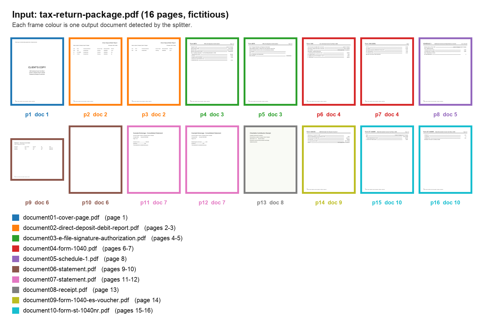
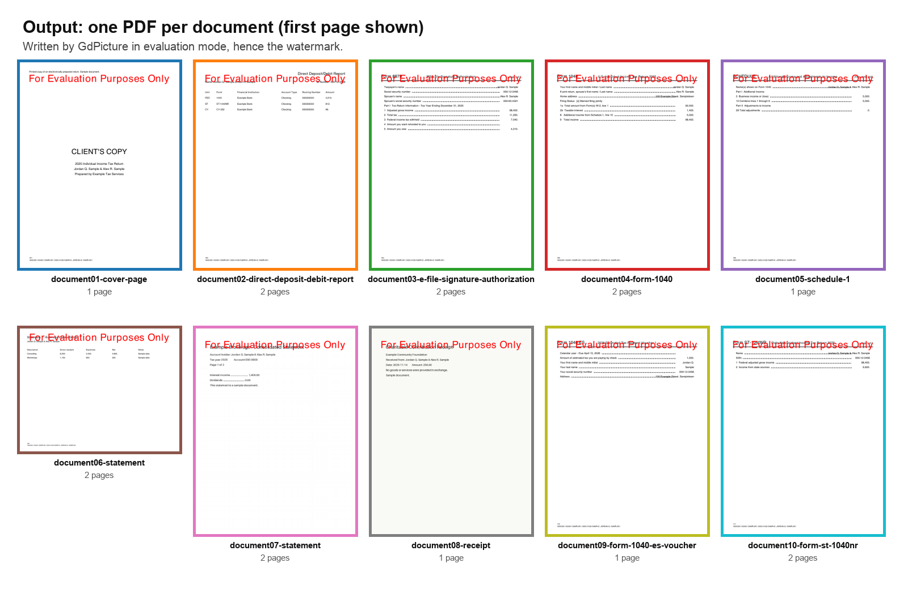

# Nutrient Document Splitting

A Nutrient.io demo that splits one PDF made of several documents, such as a printed tax return package, into one PDF per document with GdPicture.NET.



1. **Page analysis.** For every page, GdPicture reads the page size, the text and the images. For the largest image it reads the resolution, bit depth, colour space and compression, which together act as a scanner fingerprint.
2. **Text rules.** The print-tracking footer that tax software adds to each page is removed. The splitter then looks for a form or document title (`Form 8879`, `Form 1040`, `SCHEDULE 1`, `Form ST-1040NR`, `CLIENT'S COPY`, `Statement`, ...) and for `Page X of Y` in the header.
3. **OCR.** Image-only pages without a title get a GdPicture OCR pass (English), and the text rules run again on the result.
4. **Split points.** Each change between two pages adds a weighted score. A new document starts when the score reaches 6.
5. **Output.** Each page range is copied with `ClonePages` into its own PDF, named after its first title, for example `document04-form-1040.pdf`.

Everything runs locally. No cloud service is called.

## Split signals

| Signal | Weight |
|---|---|
| Form title changed | 10 |
| Current page is `Page 1 of Y` | 10 |
| Previous page was `Page Y of Y` | 10 |
| `Page X of Y` numbers not consecutive within the same form | 8 |
| Page size or orientation changed | 8 |
| Consecutive scanned pages with a different scanner fingerprint | 6 |
| A form title appears after pages without one | 6 |
| Blank page between two documents | 5 |
| Previous page had a form title, current page has none | 4 |
| Text page followed by a scanned page, or the opposite | 2 |

A split before a page that says `Page X of Y` with X > 1 is undone when the previous document has the same title. Blank pages stay with the document before them.

The title rules in `DocumentSplitter/FormTitleDetector.cs` target US tax return packages. Change them to fit other document families.

## Prerequisites

- .NET SDK 10
- Windows, macOS or Linux
- For image-only pages: the English OCR dictionary `eng.traineddata`. It is not stored in this repository. Get it from one of these sources:
  - the [GdPicture.Resources](https://www.nuget.org/packages/GdPicture.Resources) NuGet package (`runtimes/any/native/eng.traineddata`); the app finds it in the local NuGet cache (`~/.nuget/packages/gdpicture.resources`) if it is there;
  - <https://github.com/tesseract-ocr/tessdata_fast/raw/main/eng.traineddata>.

  Put the file in an `ocr` folder in the working directory, or set `OCR_RESOURCES_PATH` to the folder that contains it. Without it, scanned pages are split on their scanner fingerprint and page signals only.
- To regenerate the sample: Python 3 with `reportlab` and `pillow`.

## Environment variables

Keys are only read from environment variables, never from code. Start from `.env.example`.

| Variable | Purpose | Default |
|---|---|---|
| `GDPICTURE_LICENSE_KEY` | GdPicture.NET license key | empty = evaluation mode |
| `OCR_RESOURCES_PATH` | Folder that contains `eng.traineddata` | `ocr` next to the app or in the working directory, then the GdPicture.Resources package in the NuGet cache |

In evaluation mode GdPicture stamps a watermark on every PDF it writes. Splitting works the same.

## Build and run

Run these from the repository root.

```bash
dotnet build DocumentSplitter
```

```bash
set -a && source .env && set +a && dotnet run --project DocumentSplitter
```

Without arguments the app splits `samples/tax-return-package.pdf` into `output/`. To split your own file:

```bash
dotnet run --project DocumentSplitter -- path/to/package.pdf path/to/output-folder
```

The output folder is created if needed. PDFs already in it are deleted first.

## Usage

The console shows what was found on each page, every split with its reasons and score, and the files written:

```text
  Page   9:          792x612 | imgs=0 | form="Statement" | formPg=-/-
  Page  10:          612x792 | imgs=0 | form="" | formPg=-/- | blank
  Page  11:          612x792 | imgs=1 | form="" | formPg=-/- | imgFp=150x150_8_PdfColorSpaceDeviceGray_ASCII85Decode,DCTDecode
...
  SPLIT before page 9 (score=18): FORM_TITLE_CHANGE ("SCHEDULE 1" -> "Statement")[10], PAGE_SIZE_CHANGE (612x792 -> 792x612)[8]
  SPLIT before page 13 (score=26): FORM_TITLE_CHANGE ("Statement" -> "Receipt")[10], PREV_FORM_LAST_PAGE (2/2)[10], IMAGE_SOURCE_CHANGE[6]
...
  document04-form-1040.pdf - pages 6-7 (2 pages)
```

The sample gives 10 documents from 16 pages:



*Output PDFs written in evaluation mode, hence the watermark.*

## Sample document

`samples/tax-return-package.pdf` is generated by `samples/generate_sample.py`. Names, numbers and amounts are invented. Social security numbers use the never-issued 000 area number. It contains a cover page, a two-page direct deposit report, Form 8879 (`Page 1 of 2`, `Page 2 of 2`), Form 1040, Schedule 1, a landscape statement, a blank separator page, two scanned statement pages from a grayscale 150 DPI "scanner", a scanned receipt from a colour 200 DPI "scanner", a Form 1040-ES voucher and a two-page state return.

```bash
python3 samples/generate_sample.py
```

## Project layout

| Path | Content |
|---|---|
| `DocumentSplitter/Program.cs` | Command line, page analysis, OCR, split scoring and output |
| `DocumentSplitter/FormTitleDetector.cs` | Footer removal, title and `Page X of Y` rules |
| `DocumentSplitter/PageInfo.cs` | What is known about each page |
| `DocumentSplitter/OcrResources.cs` | Finds the OCR dictionary |
| `samples/generate_sample.py` | Generates the fictitious sample package |
